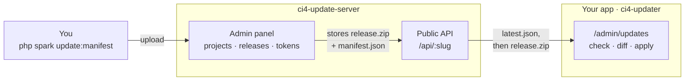
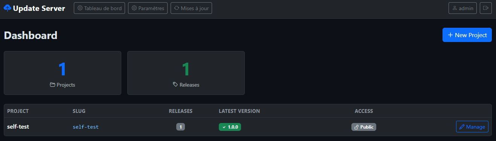
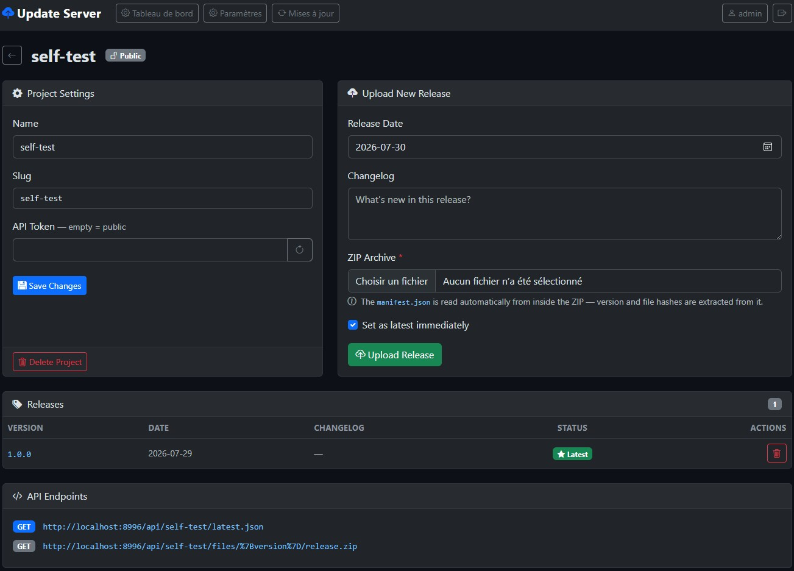
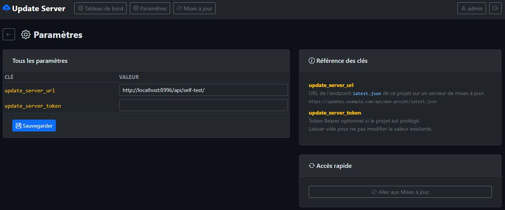

# ci4-update-server

[](https://github.com/forgelab-me/ci4-update-server/actions/workflows/tests.yml)
[](LICENSE)

A self-hosted, multi-project update server for CodeIgniter 4 apps using
[`ci4-updater`](https://github.com/forgelab-me/ci4-updater). One instance can
serve releases for several apps at once: each project gets its own slug,
optional bearer token, and release history, and exposes exactly the
`latest.json` feed `ci4-updater`'s `update_server_url` expects — no manual
JSON authoring, no GitHub Releases workaround needed.




*Dashboard — every project, its release count, current latest version and public/token access*


*Project page — upload a release (version and hashes are read from the ZIP's manifest), manage its token, copy the API endpoints*


*Settings — including this server's own updater keys, stored in the database*

## Docker

```bash
curl -O https://raw.githubusercontent.com/forgelab-me/ci4-update-server/main/compose.yaml
curl -o .env https://raw.githubusercontent.com/forgelab-me/ci4-update-server/main/.env.example
# edit .env, then:
docker compose up -d
```

Server plus MariaDB, from `ghcr.io/forgelab-me/ci4-update-server` (amd64 and
arm64). The container waits for the database, migrates, and creates the admin
account on every start — all idempotent.

Updates come from pulling a new image, so in-place self-update is off in the
container: it would write to a filesystem that is thrown away on the next
deploy.

Full guide, including configuration, backups and running behind a proxy:
**[Docker](docs/docker.md)**.

## Requirements

- PHP 8.2+
- `ext-intl`, `ext-mbstring`, `ext-zip`
- MySQL/MariaDB (or any DB supported by CodeIgniter 4)

## Install from source

The application lives in `src/`; the repository root holds packaging and
documentation. Every PHP command below runs from `src/`.

```bash
git clone https://github.com/forgelab-me/ci4-update-server.git
cd ci4-update-server/src
composer install
cp .env.example .env
```

Point your web server's document root at `src/public`.

Edit `src/.env`:

- `app.baseURL` — the public URL of this server.
- `database.default.*` — your DB credentials.
- `ADMIN_EMAIL` / `ADMIN_PASSWORD_HASH` — the first admin account. Generate a
  hash with:
  ```bash
  php -r "echo password_hash('yourpassword', PASSWORD_DEFAULT) . PHP_EOL;"
  ```

## First run

Set up the database and the initial admin account with CodeIgniter's own CLI
tooling — the same two commands in every environment, production included:

```bash
php spark migrate --all               # app + Shield + Settings tables
php spark db:seed AdminUserSeeder     # admin account from .env
```

Then log in at `/auth/login`.

`AdminUserSeeder` is idempotent: re-running it re-activates the account and
re-syncs its password hash from `.env`, so it also serves as the recovery
path if you lock yourself out of the initial admin account.

> SQLite works out of the box for local testing — set
> `database.default.DBDriver = SQLite3` and
> `database.default.database = database.db` (resolved under `writable/`) and
> run the two commands above.

## Using it

From the dashboard (`/admin`):

1. **New project** — give it a name and a slug (used in the API URL, e.g.
   `my-app`). Leave the token empty for a public feed, or set one to require
   `Authorization: Bearer <token>` on both API endpoints.
2. **Upload a release** — a ZIP built by `ci4-updater`'s
   `php spark update:manifest` (it embeds `manifest.json` at the ZIP root,
   or under a single top-level folder like GitHub's auto-generated
   archives — both are detected automatically). Add a changelog and release
   date, and optionally mark it as the latest release right away.

   The version and the directories the release covers are read from the
   manifest; the latter show in a **Covers** column, alongside the archive's
   **Size**. A release that ships `vendor/` is much larger, and is refused by
   any app that hasn't listed `vendor` in its `Config\Updater::$allowedRoots`.

   A version already uploaded is refused rather than overwritten: an app that
   downloaded it must never get different files under the same name.
3. **Set latest** — any uploaded release can be (re)promoted to "latest"
   from the project page, independently of upload order. Uploading ahead of
   what's currently latest without promoting it is easy to do by accident, so
   the dashboard flags it — a **vX.X.X pending** badge next to any project
   with a release that outranks its current latest.

   The dashboard also checks the latest release's archive is actually still
   on disk. A **File missing** badge means downloads of it are 404ing for
   every connected app right now — the file was moved, deleted, or lost some
   other way.
4. **Required step** — mark a release apps must not jump over, and it is
   served on its own until they have applied it. Worth it when a release
   ships a directory later ones don't, or a migration a later one depends on.

   The page suggests it: a release covering something the latest one doesn't
   gets a **Skippable** badge, and uploading or promoting a release says so
   outright — that is when an older one becomes skippable. Ticking the box
   stays your call.

## Connecting an app

Once the project exists, point the app at it — in its `ci4-updater`
settings (`app_settings` table or `writable/updater_settings.json`,
depending on how it's configured):

```
update_server_url   = https://updates.example.com/api/your-project-slug
update_server_token = <the project's token, if it has one>
```

Both are shown on the project page under **API Endpoints**. `ci4-updater`
resolves `{update_server_url}/latest.json` — see
[its update-server docs](https://github.com/forgelab-me/ci4-updater/blob/main/docs/update-server.md)
for the full contract.

## Public API

No auth required unless the project has a token set.

```
GET /api/{slug}/latest.json
```
```json
{
  "version": "1.2.0",
  "changelog": "…",
  "date": "2026-08-15",
  "zip_url": "https://updates.example.com/api/my-app/files/1.2.0/release.zip",
  "manifest_url": "https://updates.example.com/api/my-app/files/1.2.0/manifest.json"
}
```

Add `?from={installed version}` and the response also reports what installing
the latest release directly would step over:

```
GET /api/{slug}/latest.json?from=1.1.0
```
```json
{
  "version": "1.4.0",
  "skipped_versions": ["1.2.0", "1.3.0"],
  "missed_roots": ["vendor"]
}
```

`missed_roots` lists directories a skipped release covered that this one does
not — they would be left behind, since the latest release never touches them.
Empty in the usual case where every release covers the same directories.
`ci4-updater` sends this parameter on its own and shows the warning in its
update panel; without it, the response keeps exactly the shape above.

A release marked **Required step** on the project page goes further: it is
served *instead of* the newest one until it has been applied, so an app walks
through it rather than jumping over it.

```json
{
  "version": "1.2.0",
  "zip_url": "https://updates.example.com/api/my-app/files/1.2.0/release.zip",
  "required_step": true,
  "latest_version": "1.4.0"
}
```

The app applies 1.2.0, checks again, and is handed the next step or the latest
release. The project page suggests the checkbox — a *Skippable* badge — on any
release covering a directory the newest one doesn't; ticking it stays your
call.

```
GET /api/{slug}/files/{version}/release.zip
GET /api/{slug}/files/{version}/manifest.json
```

Both stream the file directly — `writable/uploads/` itself is never exposed.

## Publishing from CI

A pipeline can upload a release instead of the panel form. Two ways to get a
credential, one endpoint to use it:

- **A publish token** — created on the project page, scoped `publish:{slug}`,
  optionally with an expiry. One secret in the workflow.
- **Trusted Publishing** — no stored secret. GitHub Actions or GitLab CI mints
  an identity token for the workflow, the server checks it against a trusted
  publisher pinned on the repository *and* the numeric account id — optionally
  down to one workflow file — and hands back a 15-minute publish token.

```
POST /api/{slug}/publish/token    Authorization: Bearer <CI identity token>
POST /api/{slug}/releases         Authorization: Bearer <publish token>
```

Publishing this way never promotes a release to latest, and a version that
already exists is refused rather than overwritten.

See **[Publishing from CI](docs/publishing.md)** for the workflow YAML, and for
the question that matters more than either option: where the signing key lives.

## Security

- The admin panel (`/admin/*`) is authenticated via
  [`codeigniter4/shield`](https://github.com/codeigniter4/shield) — only
  admins should have accounts here, since uploading a release controls what
  every connected app downloads and installs.
- Give each project a token (`Projects → regenerate token`) unless the
  release is genuinely meant to be public. Tokens are checked with
  `hash_equals()` against the `Authorization: Bearer` header.
- Publish credentials are Shield access tokens: stored hashed, scoped to one
  project, and expiring per token. They can add a release but never promote
  one, nor mark one as a required step unless it is newer than everything the
  project has — see [Publishing from CI](docs/publishing.md). They are revoked
  when their project is deleted or renamed, since they are scoped to the slug.
- Uploaded archives are size-checked end to end — the ZIP itself, and the
  `manifest.json` read out of it before it ever reaches memory — so a crafted
  upload cannot exhaust server memory.
- `POST /api/{slug}/publish/token` and `POST /api/{slug}/releases` are
  rate-limited per IP, on top of Shield's own throttling on `/auth/login`.
  Behind a reverse proxy, set `TRUSTED_PROXIES` ([Docker guide](docs/docker.md#behind-a-reverse-proxy))
  — without it every client shares the proxy's address, and so one limit.
- Serve this over HTTPS. Every app pointed at it treats its response as
  trusted — see the
  [Security section of ci4-updater](https://github.com/forgelab-me/ci4-updater#security)
  for why that matters.
- `.env` is git-ignored on purpose — never commit real credentials. Only
  `.env.example` (placeholders) is tracked.

## Self-updating

This server runs on [`ci4-updater`](https://github.com/forgelab-me/ci4-updater)
itself — dogfooding the same package every app installs. It stores its
`update_server_url`/`update_server_token` in its own `app_settings` table
(via a `Config\Updater::$settingsClass` override, see
[Custom settings storage](https://github.com/forgelab-me/ci4-updater/blob/main/docs/configuration.md#custom-settings-storage))
instead of the package's default JSON file, so those two settings sit
alongside every other setting on the `/admin/settings` page.

To cut a release of this server itself: bump `src/app/Config/Updater.php`, run
`php spark update:manifest` from `src/`, upload the resulting ZIP as a release for its
own project (e.g. slug `update-server`, pointing `update_server_url` at
itself or another instance), then use the `/admin/updates` panel to check,
download, diff, and apply — with automatic backup and DB migrations.

If `update_server_url` points at a *different* origin than this install, that
project's token is only sent when the two share an origin — `ci4-updater`
2.11+ drops it across origins so a token can't leak to wherever a redirect
happens to end up. Point at another instance's token-protected project only if
it is reachable on the same origin, or leave that project public.

While an update is writing files, every route except `/admin/updates` itself
and the login form answers `503` — including the public API, so a connected app
never fetches a release mid-write. The window closes as soon as writing
finishes, or on its own after `Config\Updater::$maintenanceTtl` (ten minutes) if
the process dies first.

**Dependencies with their own migrations.** A release that ships `vendor/` can
bring a package whose new version needs a schema change (Shield adding a
column, say). Those migration files only exist once `vendor/` has been swapped,
so the update lists them when it is downloaded, with a box ticked by default,
writes the release, and then **stays in maintenance** until you press *Run
migrations* on `/admin/updates` — or run `php spark updater:finalize`. The site
answers `503` meanwhile, up to `Config\Updater::$finalizeTtl` (an hour). If the
panel itself cannot start on the old schema, the command line is the way
through. A release that doesn't touch `vendor/` is unaffected.

Paste the matching section of [CHANGELOG.md](CHANGELOG.md) into the upload
form's *Changelog* field: that text is what other instances see in their
update panel.

## Changelog

See [CHANGELOG.md](CHANGELOG.md) — written for whoever deploys this server,
including what to do when upgrading.

## License

MIT — see [LICENSE](LICENSE).
