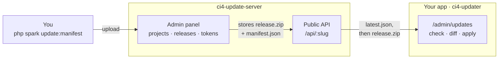

# ci4-update-server

[](https://github.com/forgelab-me/ci4-update-server/actions/workflows/tests.yml)
[](LICENSE)

A self-hosted, multi-project update server for CodeIgniter 4 apps using
[`ci4-updater`](https://github.com/forgelab-me/ci4-updater). One instance can
serve releases for several apps at once: each project gets its own slug,
optional bearer token, and release history, and exposes exactly the
`latest.json` feed `ci4-updater`'s `update_server_url` expects — no manual
JSON authoring, no GitHub Releases workaround needed.




*Dashboard — every project, its release count, current latest version and public/token access*


*Project page — upload a release (version and hashes are read from the ZIP's manifest), manage its token, copy the API endpoints*


*Settings — including this server's own updater keys, stored in the database*

## Requirements

- PHP 8.2+
- `ext-intl`, `ext-mbstring`, `ext-zip`
- MySQL/MariaDB (or any DB supported by CodeIgniter 4)

## Install

```bash
git clone https://github.com/forgelab-me/ci4-update-server.git
cd ci4-update-server
composer install
cp .env.example .env
```

Edit `.env`:

- `app.baseURL` — the public URL of this server.
- `database.default.*` — your DB credentials.
- `ADMIN_EMAIL` / `ADMIN_PASSWORD_HASH` — the first admin account. Generate a
  hash with:
  ```bash
  php -r "echo password_hash('yourpassword', PASSWORD_DEFAULT) . PHP_EOL;"
  ```

## First run

Set up the database and the initial admin account with CodeIgniter's own CLI
tooling — the same two commands in every environment, production included:

```bash
php spark migrate --all               # app + Shield + Settings tables
php spark db:seed AdminUserSeeder     # admin account from .env
```

Then log in at `/auth/login`.

`AdminUserSeeder` is idempotent: re-running it re-activates the account and
re-syncs its password hash from `.env`, so it also serves as the recovery
path if you lock yourself out of the initial admin account.

> SQLite works out of the box for local testing — set
> `database.default.DBDriver = SQLite3` and
> `database.default.database = database.db` (resolved under `writable/`) and
> run the two commands above.

## Using it

From the dashboard (`/admin`):

1. **New project** — give it a name and a slug (used in the API URL, e.g.
   `my-app`). Leave the token empty for a public feed, or set one to require
   `Authorization: Bearer <token>` on both API endpoints.
2. **Upload a release** — a ZIP built by `ci4-updater`'s
   `php spark update:manifest` (it embeds `manifest.json` at the ZIP root,
   or under a single top-level folder like GitHub's auto-generated
   archives — both are detected automatically). Add a changelog and release
   date, and optionally mark it as the latest release right away.
3. **Set latest** — any uploaded release can be (re)promoted to "latest"
   from the project page, independently of upload order.

## Connecting an app

Once the project exists, point the app at it — in its `ci4-updater`
settings (`app_settings` table or `writable/updater_settings.json`,
depending on how it's configured):

```
update_server_url   = https://updates.example.com/api/your-project-slug
update_server_token = <the project's token, if it has one>
```

Both are shown on the project page under **API Endpoints**. `ci4-updater`
resolves `{update_server_url}/latest.json` — see
[its update-server docs](https://github.com/forgelab-me/ci4-updater/blob/main/docs/update-server.md)
for the full contract.

## Public API

No auth required unless the project has a token set.

```
GET /api/{slug}/latest.json
```
```json
{
  "version": "1.2.0",
  "changelog": "…",
  "date": "2026-08-15",
  "zip_url": "https://updates.example.com/api/my-app/files/1.2.0/release.zip",
  "manifest_url": "https://updates.example.com/api/my-app/files/1.2.0/manifest.json"
}
```

```
GET /api/{slug}/files/{version}/release.zip
GET /api/{slug}/files/{version}/manifest.json
```

Both stream the file directly — `writable/uploads/` itself is never exposed.

## Security

- The admin panel (`/admin/*`) is authenticated via
  [`codeigniter4/shield`](https://github.com/codeigniter4/shield) — only
  admins should have accounts here, since uploading a release controls what
  every connected app downloads and installs.
- Give each project a token (`Projects → regenerate token`) unless the
  release is genuinely meant to be public. Tokens are checked with
  `hash_equals()` against the `Authorization: Bearer` header.
- Serve this over HTTPS. Every app pointed at it treats its response as
  trusted — see the
  [Security section of ci4-updater](https://github.com/forgelab-me/ci4-updater#security)
  for why that matters.
- `.env` is git-ignored on purpose — never commit real credentials. Only
  `.env.example` (placeholders) is tracked.

## Self-updating

This server runs on [`ci4-updater`](https://github.com/forgelab-me/ci4-updater)
itself — dogfooding the same package every app installs. It stores its
`update_server_url`/`update_server_token` in its own `app_settings` table
(via a `Config\Updater::$settingsClass` override, see
[Custom settings storage](https://github.com/forgelab-me/ci4-updater/blob/main/docs/configuration.md#custom-settings-storage))
instead of the package's default JSON file, so those two settings sit
alongside every other setting on the `/admin/settings` page.

To cut a release of this server itself: bump `app/Config/Updater.php`, run
`php spark update:manifest`, upload the resulting ZIP as a release for its
own project (e.g. slug `update-server`, pointing `update_server_url` at
itself or another instance), then use the `/admin/updates` panel to check,
download, diff, and apply — with automatic backup and DB migrations.

Paste the matching section of [CHANGELOG.md](CHANGELOG.md) into the upload
form's *Changelog* field: that text is what other instances see in their
update panel.

## Changelog

See [CHANGELOG.md](CHANGELOG.md) — written for whoever deploys this server,
including what to do when upgrading.

## License

MIT — see [LICENSE](LICENSE).
